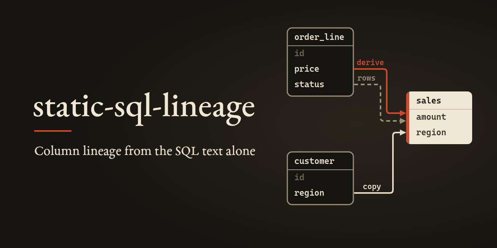

# static-sql-lineage

For every column that a SQL statement writes, static-sql-lineage tells you which
columns of which tables and views it comes from, and how: copied, computed, or only
used to choose the rows. It needs nothing but the SQL text: no database, no warehouse,
no running pipeline.

[](https://github.com/piotr-yuxuan/static-sql-lineage/actions/workflows/ci.yml)
[](https://github.com/piotr-yuxuan/static-sql-lineage/actions/workflows/cd.yml)
[](https://github.com/piotr-yuxuan/static-sql-lineage/releases/latest)
[](https://github.com/piotr-yuxuan/static-sql-lineage/commits/main)
[](https://github.com/piotr-yuxuan/static-sql-lineage/commits/main)
[](https://github.com/piotr-yuxuan/static-sql-lineage/blob/main/LICENSE)
[](https://github.com/piotr-yuxuan/static-sql-lineage/issues)
[](https://github.com/piotr-yuxuan/static-sql-lineage/blob/main/Cargo.toml)
[](https://github.com/piotr-yuxuan/static-sql-lineage/blob/main/docs/protocol.md)
[](https://crates.io/crates/polyglot-sql)
[](https://github.com/piotr-yuxuan/static-sql-lineage/blob/main/flake.nix)



## See it

[`examples/shop/`](examples/shop/) holds four DuckDB scripts of a made-up shop.
`tables.sql` declares two tables. `load.sql` fills `sales` from `order_line` with
`INSERT ... SELECT`. `views.sql` defines two views over `sales`, and `report.sql` one
view over those two. Each command below runs from the root of a clone, and
`--dialect duckdb` tells it to read the scripts as DuckDB's SQL.

In what order should these statements run, so that each comes after the tables and
views that it reads?

```console
$ static-sql-lineage graph --dialect duckdb examples/shop
examples/shop/load.sql:1:1 sales <- order_line
examples/shop/views.sql:1:1 region_revenue <- sales
examples/shop/views.sql:6:1 region_orders <- sales
examples/shop/report.sql:1:1 region_report <- region_orders, region_revenue
skipped: 0
```

Each line is a statement: its file, line and column, then the table or view that it
fills, then what it reads. `report.sql` comes before `views.sql` in the folder, but
after it here, since its view reads the two views of `views.sql`. `tables.sql` only
declares tables, so it has no line. The last line counts the statements that the tool
skipped, such as stored procedures, which it does not read yet.

Where does `revenue` in `region_revenue` come from?

```console
$ static-sql-lineage trace --dialect duckdb region_revenue.revenue examples/shop
sales.amount -> region_revenue.revenue derive examples/shop/views.sql:1:1
sales.region -> region_revenue.revenue rows examples/shop/views.sql:1:1
  order_line.quantity -> sales.amount derive examples/shop/load.sql:1:1
  order_line.status -> sales.amount rows examples/shop/load.sql:1:1
  order_line.unit_price -> sales.amount derive examples/shop/load.sql:1:1
  order_line.region -> sales.region copy examples/shop/load.sql:1:1
  order_line.status -> sales.region rows examples/shop/load.sql:1:1
```

Each line is an edge from one column to another, then its kind, then the statement
that makes it. `copy` passes the value as it is. `derive` computes a new value from it,
as `sum(amount)` does. `rows` only decides which rows there are, as `WHERE` and
`GROUP BY` do. Each indent goes one step further back, until a table that no script
fills, here `order_line`.

What would a change to `unit_price` in `order_line` reach?

```console
$ static-sql-lineage uses --dialect duckdb order_line.unit_price examples/shop
order_line.unit_price -> sales.amount derive examples/shop/load.sql:1:1
  sales.amount -> region_revenue.revenue derive examples/shop/views.sql:1:1
    region_revenue.revenue -> region_report.revenue copy examples/shop/report.sql:1:1
    region_revenue.revenue -> region_report.average_order derive examples/shop/report.sql:1:1
```

The walk goes the other way here: each indent goes one step further forward.

What does the `INSERT` of `load.sql` do, in brief?

```console
$ static-sql-lineage outline --dialect duckdb examples/shop/load.sql:1:1 examples/shop
id: examples/shop/load.sql:1:1
target: sales
mode: contribute
place: 1:1
columns: order_id, region, amount
edge: order_line.order_id -> sales.order_id copy
edge: order_line.status -> sales.order_id rows
edge: order_line.region -> sales.region copy
edge: order_line.status -> sales.region rows
edge: order_line.quantity -> sales.amount derive
edge: order_line.status -> sales.amount rows
edge: order_line.unit_price -> sales.amount derive
clause: INTO 1:8
clause: SELECT 2:1
clause: FROM 3:1
clause: WHERE 4:1
```

The statement is named by the id that `graph` printed. `mode: contribute` says that it
changes the rows of a table that is already there; a `CREATE VIEW` would say `replace`,
since it replaces whatever was there. Each `clause` gives the line and the column where
a keyword starts. Add `--json` to any of these commands for output that a program can
read.

## Who it is for

**Porting a SQL Server estate to Snowflake.** Whether a person or an agent does the
port, the four commands above answer the questions that come up again and again: what
to port first, where a column comes from, what a change would reach, and what one
statement does. They read T-SQL as SQL Server's tools script it: `GO` batches,
bracketed names, statements without semicolons, UTF-16 files.
[`examples/legacy-estate/`](examples/legacy-estate/) is the same shop in T-SQL:

```console
$ static-sql-lineage graph --dialect tsql examples/legacy-estate
examples/legacy-estate/load.sql:1:1 dbo.Sales <- dbo.OrderLine
examples/legacy-estate/views.sql:1:1 dbo.vRegionRevenue <- dbo.Sales
examples/legacy-estate/views.sql:6:1 dbo.vRegionOrders <- dbo.Sales
examples/legacy-estate/report.sql:1:1 dbo.vRegionReport <- dbo.vRegionOrders, dbo.vRegionRevenue
skipped: 0
```

The text is short enough for an agent to read in full, and `--json` gives the same to a
program.

**Column lineage for another tool.** A tool that has SQL in hand, such as a dbt
project's compiled SQL, sends one JSON request on standard input and reads one JSON
response: each statement's edges, and a note of whatever it could not trace, so that
unknown is never taken for none. dbt-lsp-plus, a language server for dbt, plans to use
it this way, but nothing calls it yet. [The protocol](docs/protocol.md) gives the
request and the response.

## Install

With Rust 1.99 or later and a C linker:

```sh
cargo install --locked --git https://github.com/piotr-yuxuan/static-sql-lineage
```

In a clone, `nix develop` gives Rust, and `cargo install --locked --path .` installs
from it. The default build reads Snowflake, T-SQL and DuckDB;
`static-sql-lineage --describe` says which dialects a build reads.

## What it does not do

- It never connects to a database or a warehouse.
- It knows nothing of dbt or Jinja: give it compiled SQL.
- It does not translate SQL from one dialect to another.
- It does not read stored procedures yet, and counts them as skipped.

## Status and licence

It is early: each change to `main` that passes its checks is published as a
[release](https://github.com/piotr-yuxuan/static-sql-lineage/releases), the first being
0.1.0. Its licence is the European Union Public Licence 1.2 ([`LICENSE`](LICENSE)).

## Further reading

- [The protocol](docs/protocol.md): how to call it, from a shell or a program, and what
  it answers.
- [The concepts](docs/concepts.md): the terms that it uses, defined.
- [The decisions](docs/decisions.md): what it is for, and what it leaves out.
